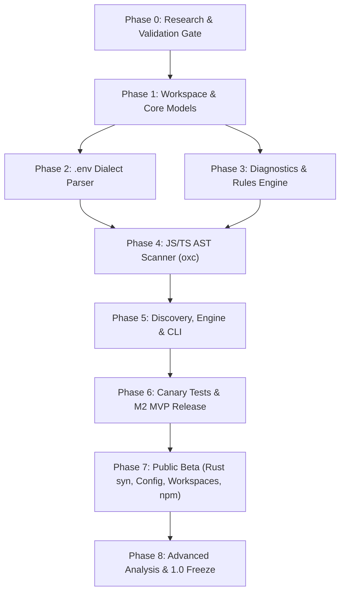

# EnvDoctor (Working Title) Blueprint & Implementation Plan
> **Environment Contract Checker**: A read-only, AST-based, safe-by-construction, CI-grade auditor keeping `.env.example` in sync with Rust & TypeScript source code.

---

## 1. Executive Summary & Strategic Positioning

### 1.1 The Core Thesis
- **The Problem**: Modern applications (especially full-stack apps mixing TypeScript and Rust, such as Next.js + Axum or Tauri) suffer from silent configuration drift. Developers add calls to `process.env` or `std::env::var` without documenting them in `.env.example`, or maintain obsolete variables, leading to broken CI/CD pipelines and deployment crashes.
- **Market Reality**: The space is crowded with lightweight scripts and runtime validators (`dotenv-linter`, `dotenv-diff`, `varlock`, `dotenvx`, `envalid`, `t3-env`). A Rust CLI named `envdoctor` already exists on crates.io, and unrelated `envdoctor` packages exist on npm and PyPI.
- **The Defensible Product**: We do not compete on unmeasured speed claims, generic secret scanning, or complex runtime schemas. Instead, we build an **Honest, Safe-by-Construction, CI-Grade Environment Contract Checker**:
  1. **Honest Static Analysis**: Distinguishes direct accesses, destructured properties, and dynamic bracket accesses. Unresolved dynamic accesses are explicitly flagged (`ENV010`), never guessed or silently ignored.
  2. **Safe by Construction**: Secret values are stripped at the tokenizer level into metadata kinds (`Empty`, `NonEmpty`, `MultiLine`). No value fields exist in the AST or Diagnostic data structures, making secret leakage mathematically impossible.
  3. **CI-First Contract**: Stable, non-reusable diagnostic codes (`ENV001`–`ENV021`, `IO001`–`IO010`), versioned JSON schema (`schemas/report.v1.schema.json`), deterministic ordering, and explicit exit codes (`0`, `1`, `2`, `3`).
  4. **Multi-Language in One Pass**: Native AST scanning for JavaScript/TypeScript (via `oxc`) and Rust (via `syn`) with workspace awareness.

### 1.2 Name Clearance & Rebranding Plan
Because `envdoctor` is taken on both crates.io and npm, the codebase must parameterize its product name in a single constant (`crate::NAME`).
* **Leading Name Candidates**: `envcontract`, `envaudit`, `envreconcile`, `envdiag`, `envsentinel`, `dotenvcheck`.
* **Action**: Perform final registry reservation before M2 release.

---

## 2. Core Architecture & Design Principles

```
┌────────────────────────────────────────────────────────────────────────┐
│                              CLI Layer                                 │
│          (clap 4, arg parsing, stream routing, exit codes)            │
└───────────────────────────────────┬────────────────────────────────────┘
                                    │
                                    ▼
┌────────────────────────────────────────────────────────────────────────┐
│                            Engine Layer                                │
│         (bounded I/O, UTF-8 checks, walker orchestration)              │
├───────────────────────────────────┬────────────────────────────────────┤
│   Discover (ignore crate)         │   Render (human, json, sarif)      │
└───────────────────┬───────────────┴────────────────────────────────────┘
                    │
                    ▼ [In-Memory Text Only — No I/O permitted]
┌────────────────────────────────────────────────────────────────────────┐
│                             Pure Core                                  │
├───────────────────┬────────────────────────────────┬───────────────────┤
│   Dialect Parser  │          AST Scanners          │   Rules Engine    │
│  (.env lexer/ast) │  - scan::js (oxc_parser)       │  (contract diff,  │
│  Values -> Kinds  │  - scan::rust (syn)            │   severity map)   │
└───────────────────┴────────────────────────────────┴───────────────────┘
```

### 2.1 Architectural Invariants
1. **Pure Core, Impure Edges**: Scanning, parsing, and rule evaluation are 100% pure functions over UTF-8 text in memory. File reading is restricted exclusively to `discover` and `engine`. Clippy `disallowed-methods` enforces zero `std::fs` calls in core modules.
2. **Values Never Leave the Lexer**: The parser extracts variable names and evaluates value classification:
   ```rust
   pub enum ValueKind {
       Empty,
       NonEmpty,
       MultiLine,
   }
   ```
   No raw strings of values are retained in memory.
3. **Deterministic Output**: Diagnostic vectors are sorted by `(path, line, column, code, name)`. Output contains no timestamps, random IDs, or non-deterministic hash iteration.
4. **Never Silently Skip**: Incomplete scans due to permissions (`IO001`), encoding (`IO002`), or limits (`IO010`) mark the report as `complete: false` and trigger exit code `3`.

---

## 3. Diagnostic Codes & Exit Codes Specification

### 3.1 Diagnostic Code Registry
| Code | Identifier | Default Severity | Description |
| :--- | :--- | :--- | :--- |
| **ENV001** | `undocumented-reference` | Warning | Environment variable accessed in source code but absent from `.env.example` |
| **ENV002** | `unused-definition` | Note | Defined in `.env.example` but not referenced anywhere in scanned source |
| **ENV003** | `missing-in-env` | Error | Defined in `.env.example` but absent in provided `.env` (downgraded for `# @optional`) |
| **ENV004** | `duplicate-key` | Warning | Same variable defined multiple times in a single `.env` file |
| **ENV005** | `malformed-line` | Error | Syntax error (unrecognized line neither comment nor assignment) |
| **ENV006** | `unsupported-syntax` | Warning | Valid shell construct unsupported by dialect (interpolation `$FOO`, command substitution `$(cmd)`) |
| **ENV007** | `empty-required-value` | Warning | Supplied `.env` has an empty value for a variable not marked optional |
| **ENV010** | `unresolved-dynamic-access` | Note | Dynamic access pattern (e.g., `process.env[computedVar]`) whose key cannot be statically resolved |
| **ENV011** | `source-parse-problem` | Warning | Source file failed AST parsing; findings for this file may be partial |
| **ENV012** | `environment-escapes` | Note | Entire environment object is aliased or spread (`const e = process.env`, `{ ...process.env }`) |
| **ENV020** | `contract-missing` | Error | Specified contract file (e.g. `.env.example`) was not found (Usage Error) |
| **ENV021** | `contract-empty` | Warning | Specified contract file exists but contains zero declared variables |
| **IO001** | `unreadable-file` | Error | Operating system permission or file reading error |
| **IO002** | `invalid-utf8` | Error | File is not valid UTF-8; lossy fallback is strictly forbidden |
| **IO003** | `not-a-file` | Error | Target path exists but is a directory or special device |
| **IO010** | `limit-exceeded` | Error | Scan terminated early because size, file count, or depth limit was exceeded |

### 3.2 Process Exit Codes
- `0`: Success (no diagnostic at or above `--fail-on` threshold, default: `warning`).
- `1`: Contract violation detected (one or more diagnostics at or above threshold).
- `2`: Usage / CLI configuration error (invalid flags, missing contract file, path not found).
- `3`: Operational error leading to incomplete results (`IO001`–`IO003`, `IO010`). Findings are still printed to stdout, operational error printed to stderr.

---

## 4. Multi-Step Implementation Plan



---

### Phase 0: Problem Validation & Go/No-Go Gate
- [ ] **Step 0.1: Run Competitor Benchmark Experiment (Hypothesis H1)**
  - Select 15 open-source repositories (5 Next.js, 5 mixed TS/Rust, 5 Node backends).
  - Benchmark `dotenv-linter`, `dotenv-diff`, and `mangodxd/envdoctor`.
  - Hand-label ~200 environment references across the corpus.
  - Calculate false positive and recall rates. *Kill criterion: Best tool achieves $\ge 90\%$ recall and $\le 5\%$ false positives.*
- [ ] **Step 0.2: Assess Mixed Repo Need (Hypothesis H2)**
  - Audit 10 repositories mixing Rust and TypeScript (Tauri, Axum + Next.js).
  - Verify whether current tooling supports single-pass checking.
- [ ] **Step 0.3: Final Name Clearance**
  - Verify uniqueness across crates.io, npm, GitHub organizations, PyPI, and trademark registers.
  - Settle on working/final project identifier.
- [ ] **Step 0.4: Decision Record**
  - Write and commit `docs/decisions/0001-go-no-go.md`.

---

### Phase 1: Workspace Scaffolding & Foundation
- [x] **Step 1.1: Initialize Cargo Workspace & Project Structure**
  - Set up workspace root `Cargo.toml` and crate `crates/envdoctor`.
  - Configure `rust-toolchain.toml` with pinned MSRV compatible with `oxc_parser` (Rust 1.97+).
  - Configure `clippy.toml` with `disallowed-methods` disallowing `std::fs` inside core crates.
  - Configure `deny.toml` for cargo-deny license and vulnerability audits.
- [x] **Step 1.2: Core Data Types (`model/`)**
  - Implement `RelPath`, `Span` (line, col, offset), and `EnvName`.
  - Define `ValueKind` (`Empty`, `NonEmpty`, `MultiLine`).
  - Implement `Definition` (name, span, value kind, is_optional).
  - Implement `Reference` (name, span, evidence_kind).
  - Define `EvidenceKind`:
    - `DirectMember`: `process.env.FOO`
    - `BracketLiteral`: `process.env['FOO']`
    - `Destructured`: `const { FOO } = process.env`
    - `DynamicUnresolved`: `process.env[expr]`
    - `WholeObjectEscape`: `const x = process.env`
- [x] **Step 1.3: Safe-by-Construction Redaction System**
  - Implement zero-leakage types: values must never implement `std::fmt::Debug`, `std::fmt::Display`, or `serde::Serialize`.
  - Create compile-fail integration test harness with `trybuild` proving that diagnostics cannot carry value strings.

---

### Phase 2: Dialect Parser (`dialect/`)
- [x] **Step 2.1: Hand-written Tokenizer and Parser**
  - Implement state machine handling:
    - Variable assignment: optional `export `, unquoted/single/double quoted keys and values.
    - Strict ASCII key validation (`[A-Za-z_][A-Za-z0-9_]*`), emitting `ENV005` on violation.
    - Inline comments (` # comment` after whitespace) vs literal hashes in quotes.
    - Escapes in double quotes (`\n`, `\r`, `\t`, `\\`, `\"`).
    - Multi-line quoted strings (tracking line numbers accurately across newlines).
    - `# @optional` doc-comment annotations on preceding line.
- [x] **Step 2.2: Unsupported Constructs Detection**
  - Recognize variable expansion (`$VAR`, `${VAR}`) and command substitution (`$(command)`).
  - Emit `ENV006` (unsupported-syntax) while preserving key identification.
- [x] **Step 2.3: Duplicate Key Tracking**
  - Track seen keys per file, emitting `ENV004` on duplicate occurrences (last definition wins).
- [x] **Step 2.4: Dialect Parser Verification**
  - Implement table-driven unit tests for all RFC/dialect cases.
  - Implement property-based testing with `proptest` ensuring parser never panics on arbitrary byte strings.
  - Set up `cargo-fuzz` target in `fuzz/fuzz_targets/fuzz_dialect.rs`.

---

### Phase 3: Diagnostics & Rules Engine (`diagnostics/`, `rules/`)
- [ ] **Step 3.1: Serializable Diagnostic & Report System**
  - Implement `Diagnostic` struct (code, severity, name, locations, message, evidence).
  - Implement `Summary` (scanned files count, skipped files, total errors, `complete: bool`).
  - Implement `Report` with `schema_version = 1` and `tool_version`.
  - Generate and validate `schemas/report.v1.schema.json`.
- [ ] **Step 3.2: Rules Engine Implementation**
  - Pure function: `evaluate_contract(contract: &Contract, definitions: &[Definition], references: &[Reference]) -> Vec<Diagnostic>`.
  - **Rule 1 (`ENV001`)**: Reference found in code without corresponding contract definition.
  - **Rule 2 (`ENV002`)**: Contract definition not present in references.
  - **Rule 3 (`ENV003`)**: Contract definition missing from provided `.env` (skipped or downgraded if definition has `@optional`).
  - **Rule 4 (`ENV007`)**: Variable in `.env` has empty value when contract definition is not optional.
  - **Rule 5 (`ENV020`/`ENV021`)**: Contract missing or empty.
- [ ] **Step 3.3: Deterministic Sorting**
  - Implement strict ordering on diagnostics: `path` -> `line` -> `column` -> `code` -> `name`.

---

### Phase 4: JavaScript & TypeScript AST Scanner (`scan::js`)
- [ ] **Step 4.1: Oxc Parser Adapter**
  - Encapsulate `oxc_parser`, `oxc_allocator`, and `oxc_ast` behind internal `scan::js::scan_source` function.
  - Guarantee that no `oxc` types leak into the public API.
- [ ] **Step 4.2: AST Visitor for Access Patterns**
  - Implement AST visitor extracting:
    1. Member expression: `process.env.VAR_NAME`, `import.meta.env.VAR_NAME`.
    2. Bracket access with literal: `process.env['VAR_NAME']`, `process.env["VAR_NAME"]`.
    3. Template literal without expressions: ``process.env[`VAR_NAME`]``.
    4. Object destructuring: `const { VAR_A, VAR_B: renamed, VAR_C = defaultVal } = process.env`.
    5. Rest pattern destructuring: `const { VAR_A, ...rest } = process.env` -> Record `VAR_A` reference and emit `ENV012`.
    6. Optional chaining: `process.env?.VAR_NAME`.
    7. Dynamic bracket access: `process.env[dynamicVar]` -> Emit `ENV010` (unresolved).
    8. Whole-object aliasing: `const myEnv = process.env` -> Emit `ENV012`.
- [ ] **Step 4.3: Comments & String Shielding**
  - Guarantee that string literals and comments containing `process.env.FOO` are never recognized as references.
- [ ] **Step 4.4: Recovery from Parse Errors**
  - In files with syntax errors, capture partial AST if possible; emit `ENV011` (source-parse-problem) and mark scan incomplete without crashing.

---

### Phase 5: File Discovery, Engine Orchestration & CLI
- [ ] **Step 5.1: File Discovery with `ignore` Crate (`discover.rs`)**
  - Walk directory trees respecting `.gitignore` and `.ignore`.
  - Do not follow symlinks by default (`follow_symlinks: false`).
  - Ignore standard build/vendor folders: `node_modules/`, `target/`, `dist/`, `build/`, `.next/`, `.git/`.
  - Allow manual override with `--include-ignored`.
- [ ] **Step 5.2: Safe Bounds & Limits**
  - Max file size limit (default: 2 MB per file).
  - Max total file count (default: 10,000 files).
  - Max directory recursion depth (default: 30).
  - Emit `IO010` (limit-exceeded) if bounds are surpassed, setting `complete: false`.
- [ ] **Step 5.3: Orchestration Engine (`engine.rs`)**
  - Pure/Impure boundary: read files boundedly into memory, verify valid UTF-8 (emit `IO002` if invalid), pass text buffers into `dialect` and `scan`.
  - Collect diagnostics, apply deterministic sorting, construct final `Report`.
- [ ] **Step 5.4: Format Renderers (`render/`)**
  - `render/human.rs`: Formatted terminal output with file locations, ANSI colors (configurable `--color`), clean code badges, and advice hints.
  - `render/json.rs`: Strict JSON serialization matching JSON schema.
  - Stream separation: Pure report to `stdout`, operational/progress logs to `stderr`.
- [ ] **Step 5.5: CLI Interface with `clap` (`cli.rs`, `main.rs`)**
  - Arguments:
    - `--contract <PATH>` (default: `.env.example`)
    - `--env <PATH>` (optional real `.env` file to audit)
    - `--path <PATHS...>` (target source directories/files, default: current directory)
    - `--format <human|json>` (default: `human`)
    - `--fail-on <error|warning|note>` (default: `warning`)
    - `--no-color`
  - Map final report severity to exit codes (`0`, `1`, `2`, `3`).

---

### Phase 6: Redaction Validation & MVP Release (M2 Gate)
- [ ] **Step 6.1: Canary Secret Leakage Testing Suite (`tests/redaction.rs`)**
  - Construct comprehensive test fixtures with synthetic high-entropy canary strings:
    `SUPER_SECRET_CANARY_VALUE_XYZ_987654321`.
  - Execute end-to-end CLI runs across:
    - Valid assignments
    - Malformed lines
    - Unsupported syntax
    - Dynamic access patterns
    - CLI crashes and forced panic unwinds
  - Assert that stdout, stderr, and JSON outputs NEVER contain the canary string.
- [ ] **Step 6.2: Conformance Suite (`fixtures/conformance/`)**
  - Create standardized test corpus with expected `report.json` outputs for:
    - Pure TypeScript project
    - Mixed JS/TS project with dynamic access
    - Missing vs. optional variables
    - Monorepo manual directories
- [ ] **Step 6.3: Packaging & Release Automation**
  - GitHub Actions matrix workflow building release binaries for:
    - `x86_64-unknown-linux-gnu` & `x86_64-unknown-linux-musl`
    - `aarch64-unknown-linux-gnu`
    - `x86_64-apple-darwin` & `aarch64-apple-darwin`
    - `x86_64-pc-windows-msvc`
  - Run `cargo publish --dry-run` and verify metadata.

---

### Phase 7: Public Beta Expansion (M3)
- [ ] **Step 7.1: Rust AST Scanner (`scan::rust` via `syn`)**
  - Add feature flag `rust` (enabled by default).
  - Use `syn` (with `full` and `visit` features) to scan:
    - `std::env::var("KEY")`, `env::var("KEY")`, `var_os("KEY")`
    - `env!("KEY")` and `option_env!("KEY")`
    - `std::env::vars()` -> Emit `ENV012`
    - Non-literal expressions `env::var(&my_key)` -> Emit `ENV010`
    - Re-parse standard macro invocations (e.g. `println!`, `format!`).
- [ ] **Step 7.2: TOML Configuration Support**
  - Introduce optional `envdoctor.toml`:
    ```toml
    [contract]
    path = ".env.example"

    [audit]
    fail_on = "warning"
    ignore_keys = ["NODE_ENV", "DEBUG"]

    [severities]
    ENV002 = "ignore" # Ignore unused definitions
    ```
  - CLI flags strictly override configuration file settings.
- [ ] **Step 7.3: Monorepo & Workspace Discovery**
  - Support Cargo workspaces (`Cargo.toml` `[workspace]`) and npm/pnpm/yarn workspaces (`package.json`, `pnpm-workspace.yaml`).
  - Scan individual packages against their package-level `.env.example` while checking common root contracts.
- [ ] **Step 7.4: SARIF 2.1.0 & GitHub Annotations**
  - Implement `render/sarif.rs` supporting SARIF 2.1.0 JSON schema for direct integration with GitHub Code Scanning alerts.
- [ ] **Step 7.5: npm Binary Distribution Packages (`packages/npm/`)**
  - Create root npm package that delegates execution to platform-specific optional binary dependencies (`@envdoctor/cli-linux-x64`, `@envdoctor/cli-darwin-arm64`, etc.).
  - Verify zero-install execution via `npx envdoctor`.

---

### Phase 8: Advanced Capabilities & 1.0 Release (M4–M5)
- [ ] **Step 8.1: Semantic Scope Resolution (`oxc_semantic`)**
  - Track local identifier renames:
    ```ts
    const e = process.env;
    e.MY_VAR; // Resolves to MY_VAR instead of leaving ENV012 uninspected
    ```
  - Resolve simple local string constants passed into bracket access:
    ```ts
    const KEY = 'DATABASE_URL';
    process.env[KEY]; // Resolves to DATABASE_URL
    ```
- [ ] **Step 8.2: Framework Presets**
  - Add preset profiles for Next.js (`NEXT_PUBLIC_`), Vite (`VITE_`), SvelteKit (`PUBLIC_`).
- [ ] **Step 8.3: Safe Atomic Write Mode (`--write`)**
  - Provide interactive `--write` flag to update `.env.example` with discovered missing keys:
    - Displays terminal diff first.
    - Prompts user confirmation.
    - Writes atomically via temporary replacement file.
    - Refuses to write if git working directory is dirty.
- [ ] **Step 8.4: Freeze 1.0 & Long-Term Support**
  - Lock diagnostic codes, JSON schema v1, and CLI arguments.
  - Publish final documentation, security policy, and benchmark report.

---

## 5. Test Strategy & Verification Matrix

| Component | Target Under Test | Verification Technique | Tools Used |
| :--- | :--- | :--- | :--- |
| **Dialect Lexer** | Quotes, newlines, malformed lines, escapes | Table tests, property fuzzing | `proptest`, `cargo-fuzz` |
| **Redaction** | Zero secret value in any output stream | Canary injection across all paths | Synthetic canary strings, `grep` assertion |
| **JS/TS Scanner** | Destructuring, optional chains, dynamic keys | Golden file AST comparisons | `oxc_parser`, fixture tests |
| **Rust Scanner** | Macro bodies, `env!` macros, dynamic vars | Snapshot tests | `syn`, fixture tests |
| **File Discovery** | Symlink traversal, ignore rules, size limits | Filesystem tempdir tests | `tempfile`, multi-platform CI |
| **CLI & CI** | Arguments, formatting, exit codes | Black-box subprocess tests | `assert_cmd`, `predicates` |
| **JSON Schema** | Output validity | Schema validation | `jsonschema` in CI pipeline |

---

## 6. Directory Structure & Workspace Layout

```
envdoctor/
├── Cargo.toml                   # Workspace root manifest
├── Cargo.lock
├── rust-toolchain.toml          # Pinned Rust toolchain (1.97+)
├── clippy.toml                  # Disallowed methods (std::fs restrictions)
├── deny.toml                    # License and dependency audit policy
├── README.md
├── CHANGELOG.md
├── LICENSE-MIT
├── LICENSE-APACHE
├── schemas/
│   └── report.v1.schema.json    # Versioned JSON output schema
├── docs/
│   ├── dialect.md               # Formal specification of the .env dialect
│   ├── diagnostics.md           # Catalog of all ENVxxx and IOxxx codes
│   └── decisions/
│       └── 0001-go-no-go.md
├── crates/
│   └── envdoctor/               # Primary library + CLI crate
│       ├── Cargo.toml
│       ├── src/
│       │   ├── lib.rs           # Public library API (audit, audit_paths)
│       │   ├── main.rs          # CLI entry point
│       │   ├── cli.rs           # Clap definition
│       │   ├── model/           # Definitions, References, Spans, ValueKind
│       │   ├── dialect/         # Pure .env tokenizer & parser
│       │   ├── scan/            # AST scanner modules
│       │   │   ├── mod.rs
│       │   │   ├── js.rs        # oxc_parser adapter
│       │   │   └── rust.rs      # syn adapter (feature = "rust")
│       │   ├── rules/           # Contract comparison logic
│       │   ├── diagnostics/     # Codes, Severities, Report model
│       │   ├── discover.rs      # Bounded filesystem walker (ignore crate)
│       │   ├── engine.rs        # Pipeline orchestrator
│       │   └── render/          # Human, JSON, SARIF renderers
│       └── tests/
│           ├── cli.rs
│           ├── conformance.rs
│           └── redaction.rs     # Canary leak tests
├── fixtures/
│   └── conformance/             # Shared golden test inputs & expected JSON
│       ├── simple_ts/
│       ├── mixed_rust_ts/
│       └── dynamic_keys/
└── packages/
    └── npm/                     # Optional binary wrapper packages for npm
```

